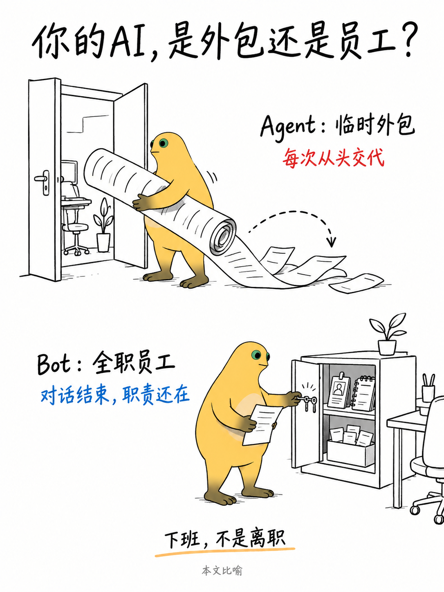
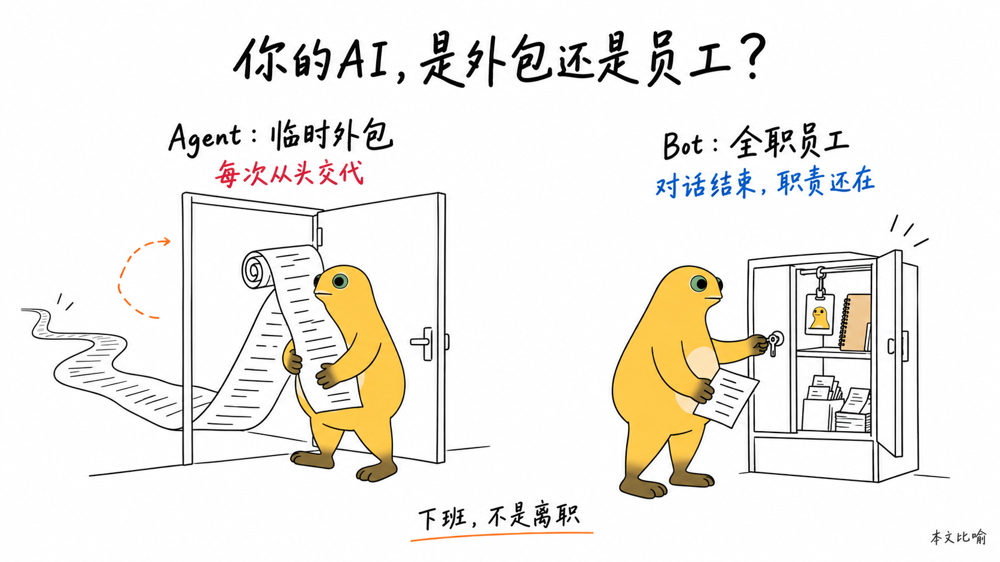
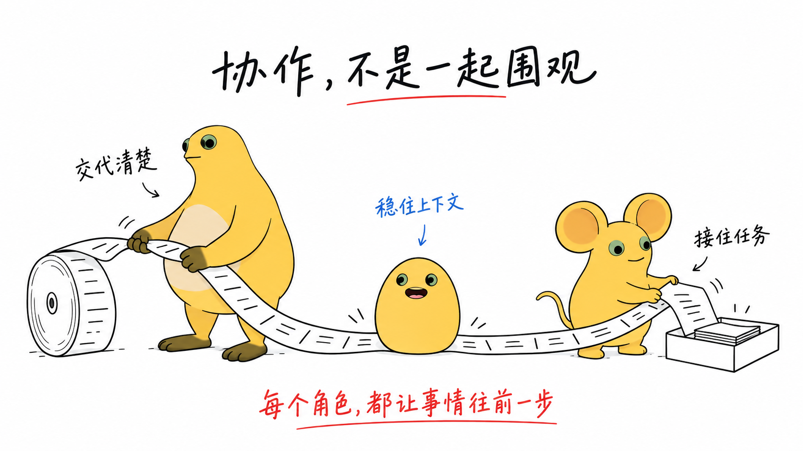

# 奶娃知识卡片（naiwa-cards）

把文章、段落或观点变成角色参与的手绘知识卡片。默认 **3:4 竖版**，可选 **16:9 横版**，每张单独生图，包含图中文字。

新版以“一个问题或观点 + 一场角色动作 + 少量短标注”为默认表达；结论可选。比较、清单和步骤类内容仍可使用编号要点，不再强制每张套同一版式。

## 画面风格

- 纯白背景，细黑手绘线条，大量留白。
- 当前角色保留招牌色，道具不填色；少量红蓝批注，可按需用橙色路径线。
- 角色参与核心动作，认真操作一个奇怪但成立的场景；不只是站在文字旁边。
- 参考图锁定身份、比例和配色，三维参考转为二维手绘。
- 所有可见文字列入白名单，逐张检查角色、文字和实际图片比例。

## 示例效果

以下三张为新版场景隐喻与多角色测试图，仅用于展示表达方式，不作为固定构图模板。

### Agent 与 Bot：3:4 竖版

以“临时外包 / 全职员工”为本文比喻，上下两个场景表现重复交代与职责延续。该比喻不代表所有 Agent 和 Bot 的通用技术定义。

实际尺寸：1086×1448，精确 3:4。

### Agent 与 Bot：横版

同一观点按横向空间重新构图，左右对照，适合正文配图。

实际尺寸：1672×941，接近 16:9，非严格 16:9。

### 多角色：任务交接

奶蛙拉出任务长卷，奶蛋用身体压住纸张，奶鼠将任务送进收件槽。三个角色各有动作；奶鼠保留大耳与鼠尾，奶蛋不添加四肢。

实际尺寸：1672×941，接近 16:9。测试图仍有少量角色明暗，作为迭代参考保留。

## 使用

将本目录放入助手的 skills 目录，然后可以说：

> 用 naiwa-cards 把这篇文章做成 4 张知识卡片。

> 做成 16:9 横版，让奶蛙在场景里实际操作，少写文字。

> 同一观点分别做 3:4 和 16:9 两个版本，按各自比例重新构图。

> 先不要生图，给我每张的观点、场景隐喻、角色动作和文字清单。

未指定比例默认 3:4；“横版”对应 16:9，“竖版”对应 3:4。明确要求生成时直接逐张执行；只要求规划时先交付方案。

成图保存到工作区 `assets/<topic-slug>-cards/`，例如 `01-topic-3x4.png`、`01-topic-16x9.png`。同一观点的双比例分别构图，不拉伸或用加白边代替横版设计。

## 角色与参考

默认角色是奶娃；实际生成以 `config/active-ip.md` 中激活的角色为准。自有角色参考图放在 `assets/character/<slug>/`，档案放在 `ips/<slug>.md`。

角色库已加入奶鼠（超大圆耳、细鼠尾）和奶蛋（无四肢的黄色蛋形），多人互动时可与当前奶蛙搭配，各自保留造型和配色。默认不凑齐全员；按场景需要选角。奶蛋通过滚动、承托、压住或阻挡参与动作，不擅自加手脚。可直接说：“用奶蛙和奶鼠演示任务交接”或“让奶鼠和奶蛋合作完成这个动作”。多角色规则见 `references/multi-character.md`。

旧 `examples/sample/card-01.png` 保留为清单模式示例，不是新版默认版式。构思细节见 `references/visual-storytelling.md`，生图模板见 `references/prompt-template.md`。

## 来源与许可

场景隐喻、角色核心动作参与和留白方法受到 [Ian Xiaohei Illustrations](https://github.com/helloianneo/ian-xiaohei-illustrations) 启发；本版保留独立角色体系，不内置小黑形象或对方例图。

MIT。原许可见 `LICENSE`。
